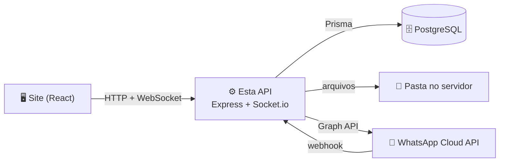
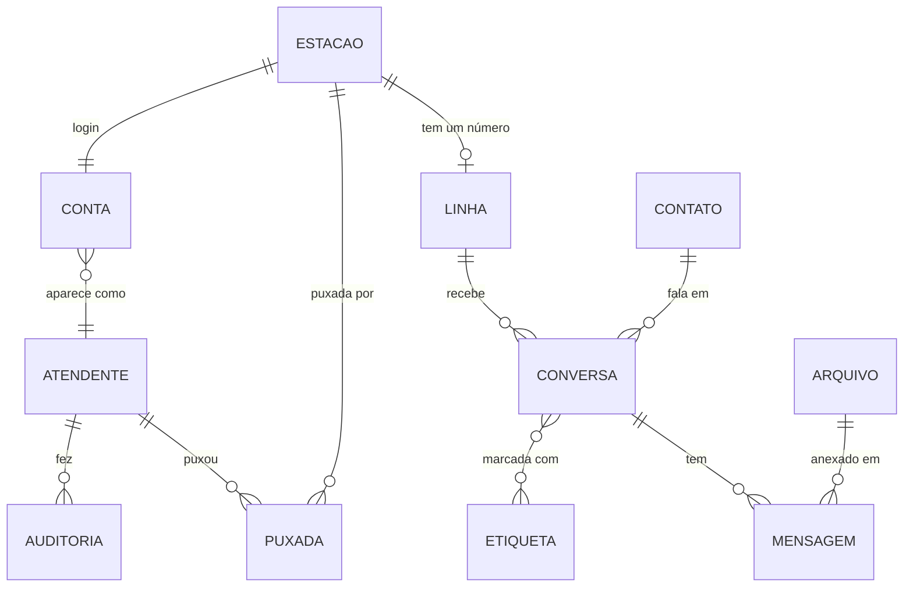

# Talk Atendimento: servidor (API)

O **servidor** do [Talk Atendimento](https://github.com/thepaulojorge/talk-atendimento), uma central de atendimento pelo WhatsApp para equipes que trabalham em estações.

É ele que **guarda** tudo (no banco de dados), **decide** quem pode ver e fazer o quê, **avisa ao vivo** as telas da equipe e **conversa com o WhatsApp** de verdade.

> 📖 O que o sistema faz, para quem ele serve e como usar: veja o README do [site](https://github.com/thepaulojorge/talk-atendimento). Este aqui é o lado técnico: como o servidor funciona, como rodar e como ligar ao WhatsApp.

🔗 Publicado em: https://talk-atendimento-api.onrender.com/api/saude

---

## Sumário

1. [Visão geral](#1-visão-geral)
2. [Rodar no seu computador](#2-rodar-no-seu-computador)
3. [Variáveis de ambiente (.env)](#3-variáveis-de-ambiente-env)
4. [O banco de dados](#4-o-banco-de-dados)
5. [As rotas da API](#5-as-rotas-da-api)
6. [Tempo real (Socket.io)](#6-tempo-real-socketio)
7. [Ligar ao WhatsApp de verdade](#7-ligar-ao-whatsapp-de-verdade)
8. [Publicar (Render + Neon)](#8-publicar-render--neon)
9. [Segurança](#9-segurança)
10. [Organização das pastas](#10-organização-das-pastas)
11. [Problemas comuns](#11-problemas-comuns)

---

## 1. Visão geral



| Tecnologia | Para quê |
|---|---|
| **Node.js 22.18+** | Roda o JavaScript no servidor |
| **Express 5** | As rotas da API (`/api/...`) |
| **Prisma 7** + **PostgreSQL** | O banco de dados |
| **Socket.io** | Avisos ao vivo para as telas |
| **jsonwebtoken** + **bcryptjs** | Login (token e senhas) |
| **express-rate-limit** | Limite de tentativas de login |
| **ffmpeg-static** | Converter o áudio do navegador (WebM) para o formato do WhatsApp (OGG) |

---

## 2. Rodar no seu computador

**Você vai precisar de:**
- **Node.js 22.18 ou mais novo** (`node -v` mostra a sua versão)
- Um banco **PostgreSQL**. O mais fácil é criar um grátis no [Neon](https://neon.tech) (veja a [seção 4](#4-o-banco-de-dados))

**Passo a passo:**

```bash
# 1. Baixar o projeto
git clone https://github.com/thepaulojorge/talk-atendimento-api.git
cd talk-atendimento-api

# 2. Instalar as dependências (também gera o "cliente" do Prisma)
npm install

# 3. Criar o seu .env a partir do modelo
#    (no Windows: copy .env.example .env)
cp .env.example .env
```

4. Abra o `.env` e preencha: `DATABASE_URL`, `DIRECT_URL` e `JWT_SEGREDO` (a [seção 3](#3-variáveis-de-ambiente-env) explica cada um).

```bash
# 5. Criar as tabelas no banco
npm run banco:aplicar

# 6. Colocar os dados de exemplo (⚠️ apaga o que houver no banco)
npm run banco:popular

# 7. Ligar o servidor
npm run dev
```

Pronto: abra http://localhost:3000/api/saude. Deve aparecer `{"status":"ok", ...}`.

### Os comandos

| Comando | O que faz |
|---|---|
| `npm run dev` | Liga o servidor e reinicia sozinho ao salvar um arquivo |
| `npm start` | Liga o servidor (o que o Render usa) |
| `npm run banco:migrar -- --name nome` | Depois de mudar o `schema.prisma`: cria uma migração e aplica no banco |
| `npm run banco:gerar` | Gera o "cliente" do Prisma de novo (⚠️ rode depois de toda migração) |
| `npm run banco:aplicar` | Aplica as migrações que ainda não estão no banco (sem criar novas) |
| `npm run banco:popular` | Apaga tudo e coloca os dados de exemplo: 10 estações (`estacao01@talk.com` até `estacao10@talk.com`; com `ESTACOES_EXEMPLO=70` no `.env`, até a 70), supervisão e diretoria, todas com a senha `demo123` |
| `npm run banco:zerar` | Apaga o banco inteiro e recria as tabelas do zero |
| `npm run banco:ver` | Abre o Prisma Studio: uma tela para ver e editar o banco |

> 💡 A ordem depois de mudar o banco é sempre: **migrar → gerar → popular** (se precisar dos exemplos).

---

## 3. Variáveis de ambiente (.env)

As configurações e os segredos ficam **fora do código**: no arquivo `.env` (no seu computador) e no painel do Render (na nuvem). O `.env` está no `.gitignore`: **nunca vai para o GitHub**.

| Variável | Obrigatória? | O que é |
|---|:---:|---|
| `DATABASE_URL` | ✅ | Endereço do banco **com pooling** (no Neon, o que tem `-pooler`). Usado pelo servidor |
| `DIRECT_URL` | ✅ | Endereço do banco **sem pooling**. Usado pelas migrações |
| `JWT_SEGREDO` | ✅ | Chave que assina os logins. Mínimo de 32 caracteres. Gere com:<br/>`node -e "console.log(require('crypto').randomBytes(32).toString('hex'))"` |
| `PORTA` | | Porta no seu computador (padrão: 3000). O Render usa a `PORT` dele |
| `ORIGENS_PERMITIDAS` | | Sites que podem usar a API, separados por vírgula |
| `MODO_DEMONSTRACAO` | | `true` mostra o botão "Entrar na demonstração" e libera as ferramentas de teste |
| `ESTACOES_EXEMPLO` | | Quantas estações o `banco:popular` cria (de 3 a 99; padrão 10). Use `70` para testar em escala real |
| `CONTA_DEMONSTRACAO` | | Qual conta o botão da demonstração usa (ex.: `estacao01@talk.com`) |
| `PASTA_ARQUIVOS` | | Onde guardar os arquivos enviados (padrão: a pasta `arquivos` do projeto) |
| `WHATSAPP_TOKEN` | | Chave de acesso da Meta. **Sem ela, todas as linhas ficam em modo simulado** |
| `WHATSAPP_SEGREDO_APP` | | "Chave secreta do app" da Meta: confere a assinatura dos webhooks |
| `WHATSAPP_TOKEN_VERIFICACAO` | | Um texto que você inventa, igual ao colado no painel da Meta |
| `WHATSAPP_VERSAO` | | Versão da API da Meta (ex.: `v26.0`) |

> ⚠️ **Nunca** coloque estes valores em prints, no chat ou em commits. Se um vazar, troque na hora (gere outro `JWT_SEGREDO`, faça "Reset password" no Neon, revogue o token na Meta).

---

## 4. O banco de dados

### Criar o banco no Neon (grátis)

1. Entre em [neon.tech](https://neon.tech) (dá para entrar com o GitHub) e crie um projeto
2. Clique em **Connect**
3. Com **Connection pooling ligado**, copie o endereço: esse é o `DATABASE_URL`
4. Com **Connection pooling desligado**, copie de novo: esse é o `DIRECT_URL`

### O mapa do banco

O "mapa" fica em `prisma/schema.prisma`, comentado linha a linha. Resumindo:



| Tabela | O que guarda |
|---|---|
| `atendentes` | Quem aparece como autor: uma por estação ("Estação 01"), mais supervisão e diretoria |
| `contas` | Os logins (e-mail + hash da senha). Conta de **estação** (o login da estação) ou **pessoal** (supervisão, diretoria) |
| `estacoes` | As estações (nome e sigla). Cada uma tem uma conta, um "atendente" com o nome dela (o autor das mensagens) e uma linha |
| `linhas` | Os números de WhatsApp: um por estação, mais os da supervisão e da diretoria |
| `puxadas` | Quem está cobrindo qual estação agora |
| `contatos` | Os clientes |
| `conversas` / `mensagens` | O atendimento em si |
| `arquivos` | Os dados dos arquivos (o conteúdo fica na pasta do servidor) |
| `auditoria` | Edições, exclusões e conversas apagadas (com cópia do conteúdo), com a estação e o **turno** (pelo horário do login: manhã 7h-15h, tarde 15h-23h, noite 23h-7h) |
| `etiquetas`, `respostas_rapidas`, `configuracoes` | O resto |

Duas decisões importantes:
- **Exclusão "suave":** mensagem apagada não sai do banco, só ganha `apagada = true`. A supervisão continua vendo o conteúdo.
- **A auditoria não depende das conversas:** o registro guarda o nome e uma cópia, para sobreviver mesmo depois que a conversa é excluída.

---

## 5. As rotas da API

Todas começam com `/api`. As marcadas com 🔒 precisam do token de login (`Authorization: Bearer <token>`).

**Abertas**

| Método | Rota | O que faz |
|---|---|---|
| GET | `/saude` | "Estou vivo" |
| GET | `/publico/configuracao` | Nome da empresa e se a demonstração está ligada (para a tela de login) |
| POST | `/auth/entrar` | Login com e-mail e senha. Devolve o token |
| POST | `/auth/demonstracao` | Login pelo botão da demonstração |
| GET / POST | `/whatsapp/webhook` | Onde a Meta avisa as mensagens novas (com assinatura conferida) |

**Com login** 🔒

| Método | Rota | O que faz |
|---|---|---|
| GET | `/auth/eu` | Quem sou eu? |
| POST | `/auth/sair` | Sair (solta as estações puxadas) |
| GET | `/dados` | Tudo o que a tela precisa ao abrir (só o que a pessoa pode ver) |
| POST | `/conversas` | Iniciar conversa pela aba Contatos |
| PATCH | `/conversas/:id` | Fixar, arquivar, marcar como lida ou não lida |
| POST | `/conversas/:id/assumir` | Assumir a conversa |
| POST | `/conversas/:id/transferir` | Transferir para um colega (ou para a fila) |
| POST | `/conversas/:id/resolver` | Marcar como resolvida ou reabrir |
| PUT / DELETE | `/conversas/:id/etiquetas/:etiquetaId` | Colocar ou tirar uma etiqueta |
| DELETE | `/conversas/:id` | Excluir a conversa (com cópia na auditoria) |
| POST | `/conversas/:id/mensagens` | Enviar texto, nota, áudio ou arquivo (pelo WhatsApp, se a linha estiver ligada) |
| PATCH / DELETE | `/mensagens/:id` | Editar ou apagar (só quem escreveu) |
| POST | `/arquivos` | Enviar um arquivo (o corpo é o próprio arquivo, até 10 MB) |
| GET | `/arquivos/:id` | Abrir ou baixar (`?baixar`) um arquivo |
| PATCH | `/etiquetas/:id` | Renomear uma etiqueta personalizável |
| POST / DELETE | `/estacoes/:id/puxar` | Puxar ou soltar uma estação (atendentes) |
| GET | `/admin` | Tudo o que a tela de Configurações mostra (supervisão e diretoria) |
| POST / PUT | `/admin/estacoes` (`/:id`) | Criar ou editar uma estação: nome, sigla, e-mail, senha, número, ID na Meta, login bloqueado |
| PUT | `/admin/linhas/:id` | Número da supervisão ou da diretoria |
| PUT | `/admin/marca` | Nome da empresa (só a diretoria) |
| POST | `/demonstracao/...` | Restaurar os exemplos e simular o cliente (só com `MODO_DEMONSTRACAO=true`) |

**As respostas de erro** sempre vêm assim: `{ "erro": "explicação em português" }`, com o código certo:

| Código | Significa |
|---|---|
| 400 | O pedido veio errado (campo faltando, formato inválido) |
| 401 | Sem login, ou login vencido |
| 403 | Logado, mas sem permissão para isso |
| 404 | Não existe, **ou você não pode ver** (de propósito: assim ninguém descobre o que existe) |
| 409 | Já existe (id repetido) |
| 413 | Arquivo grande demais |
| 502 | O WhatsApp recusou (a mensagem explica o motivo) |

---

## 6. Tempo real (Socket.io)

Cada tela aberta mantém uma conexão com o servidor. O servidor separa as conexões em **salas**:

| Sala | Quem está nela | O que recebe |
|---|---|---|
| `linha:<id>` | Quem atende aquela linha | Conversas atualizadas e excluídas |
| `supervisao` | Supervisão e diretoria | Registros novos da auditoria |
| `todos` | Todo mundo logado | Etiquetas, contatos novos, estações, "recarregue" |
| `atendente:<id>` | As conexões de uma pessoa | Usada para refazer as salas quando ela puxa ou solta uma estação |

A conexão só é aceita com um token válido. Os avisos ficam em `src/tempoReal.js`.

---

## 7. Ligar ao WhatsApp de verdade

Sem configurar nada, o sistema funciona em **modo simulado**. Para uma linha usar o WhatsApp de verdade, são três partes: **Meta**, **Render** e **Configurações do sistema**.

> ℹ️ O painel da Meta muda de tempos em tempos: os nomes dos botões podem estar um pouco diferentes.

### Parte A: na Meta

1. Em [developers.facebook.com](https://developers.facebook.com), crie um app com o caso de uso **"Conectar-se com clientes pelo WhatsApp"**
2. No caso de uso, abra a **Etapa 1. Experimente**. A Meta cria um **número de teste**. Anote o **Phone Number ID** e a **Identificação da conta de mensagens**
3. Em **Configurações do app → Básico**, copie a **Chave secreta do app** (vai no `WHATSAPP_SEGREDO_APP`)
4. **Token permanente** (o do botão "Gerar token" vence em ~24 horas):
   - [business.facebook.com/settings](https://business.facebook.com/settings) → **Usuários do sistema** → **Adicionar** (Administrador)
   - **Atribuir ativos**: o app e a conta do WhatsApp, com controle total
   - **Gerar novo token**: validade **Nunca**, permissões `whatsapp_business_messaging`, `whatsapp_business_management` e `business_management`

### Parte B: no Render (variáveis de ambiente)

| Variável | Valor |
|---|---|
| `WHATSAPP_TOKEN` | O token permanente |
| `WHATSAPP_SEGREDO_APP` | A chave secreta do app |
| `WHATSAPP_TOKEN_VERIFICACAO` | Um texto inventado por você (guarde para o próximo passo) |
| `WHATSAPP_VERSAO` | A versão mostrada no painel (ex.: `v26.0`) |

### Parte C: o webhook (de volta na Meta)

1. Abra a configuração de **Webhooks** do caso de uso e preencha:
   - **URL de retorno de chamada:** `https://talk-atendimento-api.onrender.com/api/whatsapp/webhook`
   - **Verificar token:** o mesmo `WHATSAPP_TOKEN_VERIFICACAO`
2. **Verificar e salvar** (acorde o servidor antes, abrindo `/api/saude`)
3. Em **Campos do webhook**, assine **`messages`**
4. **Inscreva a conta do WhatsApp no app** (sem isso, a Meta não manda as mensagens):

   ```bash
   # No PowerShell, use curl.exe
   curl.exe -X POST "https://graph.facebook.com/v26.0/ID_DA_CONTA_DE_MENSAGENS/subscribed_apps" -H "Authorization: Bearer SEU_TOKEN"
   ```

   Resposta esperada: `{"success":true}`

### Parte D: no sistema

Entre como **diretoria** → **Configurações** → no quadrinho da estação, cole o **Phone Number ID** em **"ID na Meta"** → **Salvar**. Aparece o selo verde **WhatsApp**.

### Coisas que você vai encontrar

| Situação | Explicação |
|---|---|
| "Já passou de 24 horas desde a última mensagem do cliente" | Regra do WhatsApp: fora da janela de 24 horas, só **modelos aprovados** (templates) |
| "Só dá para enviar para números cadastrados na lista de destinatários" | No **número de teste**, só para até 5 números confirmados no painel |
| O número chega **sem o 9** (`55 21 7640-8480`) | Muitas contas brasileiras estão registradas no WhatsApp sem o 9. O sistema reconhece as duas formas como a mesma pessoa e responde no formato do WhatsApp. No número de teste, cadastre os dois formatos na lista de destinatários |
| "Business account is restricted from messaging users in this country" | Restrição atual da Meta: empresas de fora (o número de teste é dos EUA) não enviam para o Brasil. Com um **número brasileiro** da empresa, funciona. Receber funciona sempre |
| Mensagem com "⚠ Não entregue" | O WhatsApp recusou a entrega: passe o mouse para ver o motivo |
| Editar e apagar não mudam o celular do cliente | O sistema não altera mensagens que já saíram pelo WhatsApp |

**Logs úteis** (no Render, aba **Logs**):
- `📩 WhatsApp: aviso recebido da Meta`: a Meta chamou o servidor
- `⚠️ WhatsApp: assinatura inválida`: o `WHATSAPP_SEGREDO_APP` está errado
- `aviso para um número que nenhuma linha usa`: o "ID na Meta" não bate
- `✅ WhatsApp: linha ...: 1 mensagem(ns) nova(s)`: chegou e foi gravada

---

## 8. Publicar (Render + Neon)

**No Render** ([render.com](https://render.com)), crie um **Web Service** ligado a este repositório:

| Campo | Valor |
|---|---|
| Build Command | `npm install && npm run banco:aplicar` |
| Start Command | `npm start` |
| Variáveis | As da [seção 3](#3-variáveis-de-ambiente-env) (sem aspas: só o valor) |

A cada `git push` na `main`, o Render publica sozinho. O `npm install` já roda o `prisma generate` (pelo `postinstall`), e o `banco:aplicar` aplica as migrações novas.

**Sobre o plano gratuito do Render:**
- "Dorme" depois de 15 minutos sem uso, e leva ~1 minuto para acordar
- A **pasta de arquivos é apagada** a cada reinício: fotos e documentos enviados viram "Arquivo indisponível". Numa máquina da empresa (ou num plano com disco), eles ficam

---

## 9. Segurança

| Proteção | Onde está |
|---|---|
| Senhas só como hash (bcrypt, custo 10); a senha nunca volta para a tela, só dá para trocar | `rotas/admin.js`, `rotas/autenticacao.js` |
| Token JWT de 12 horas; papel conferido no banco a cada pedido | `autenticacao/tokens.js`, `autenticacao/middleware.js` |
| 10 tentativas de login erradas a cada 15 minutos | `rotas/autenticacao.js` |
| Mesmo erro e mesmo tempo de resposta para e-mail inexistente e senha errada | `rotas/autenticacao.js` (o `HASH_FALSO`) |
| Cada pessoa só vê as linhas que atende | `autenticacao/linhas.js` (a regra mais importante do sistema) |
| A demonstração nunca vê linhas reais; restaurar só pela diretoria | `autenticacao/linhas.js`, `rotas/demonstracao.js` |
| Ids validados (só letras, números, `-` e `_`) | `conversas/regras.js` |
| Arquivos: lista fechada de tipos, 10 MB, nome no disco = id, `nosniff` | `rotas/arquivos.js`, `arquivos/disco.js` |
| Webhook da Meta: assinatura HMAC SHA-256 comparada em tempo constante | `rotas/whatsapp.js` |
| Erros internos não vazam detalhes (só no log) | `app.js` |

**Melhorias planejadas:** trocar senha pela tela, "sair" invalidando o token na hora, limites de uso por pessoa, cabeçalhos de segurança (`helmet`) e faxina de arquivos órfãos.

---

## 10. Organização das pastas

```
prisma/
├── schema.prisma        o mapa do banco (comentado)
├── migrations/          o histórico de mudanças do banco (gerado pelo Prisma)
└── popular.js           npm run banco:popular
src/
├── servidor.js          liga o servidor (e o tempo real) numa porta
├── app.js               monta a API: CORS, rotas, tratamento de erros
├── banco.js             a conexão com o banco (um Prisma Client só)
├── formatos.js          do banco para o formato que o site espera
├── tempoReal.js         Socket.io: salas e avisos ao vivo
├── autenticacao/        login, token e "quais linhas esta pessoa vê"
├── conversas/regras.js  ajudantes das rotas: permissões, eventos, auditoria
├── rotas/               uma rota (ou um grupo) por arquivo
├── arquivos/disco.js    onde o conteúdo dos arquivos é guardado
├── whatsapp/            tudo do WhatsApp: Graph API, webhook, envio, áudio, números
├── dados/               os dados de exemplo (dados.json) e quem os coloca no banco
└── generated/           o cliente do Prisma (gerado; não vai para o GitHub)
```

---

## 11. Problemas comuns

| Sintoma | Causa provável e solução |
|---|---|
| `Cannot read properties of undefined (reading 'deleteMany')` no `banco:popular` | O cliente do Prisma está desatualizado: rode `npm run banco:gerar` |
| `Falta a variável JWT_SEGREDO` | O `.env` não tem `JWT_SEGREDO` (ou tem menos de 32 caracteres) |
| O site diz "Não foi possível falar com o servidor" | A API não está ligada (`npm run dev`) ou o Render ainda está acordando |
| Erro de CORS no navegador | O endereço do site não está em `ORIGENS_PERMITIDAS` |
| O botão "Entrar na demonstração" sumiu | `MODO_DEMONSTRACAO` não é exatamente `true` (minúsculo, sem aspas), ou a estação da demonstração está ligada ao WhatsApp de verdade |
| A migração avisa sobre "unique constraint" | É só um aviso: se as colunas são novas (vazias), pode confirmar com `y` |
| Mensagens do WhatsApp não chegam | Veja a lista de **logs úteis** na [seção 7](#7-ligar-ao-whatsapp-de-verdade). O mais comum: faltou o `subscribed_apps` |

---

Feito por **Paulo Jorge**. [GitHub](https://github.com/thepaulojorge)
